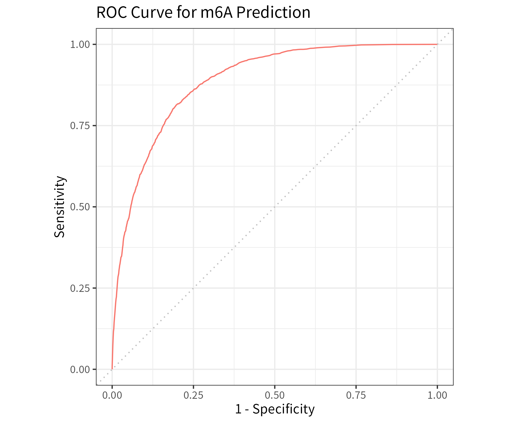
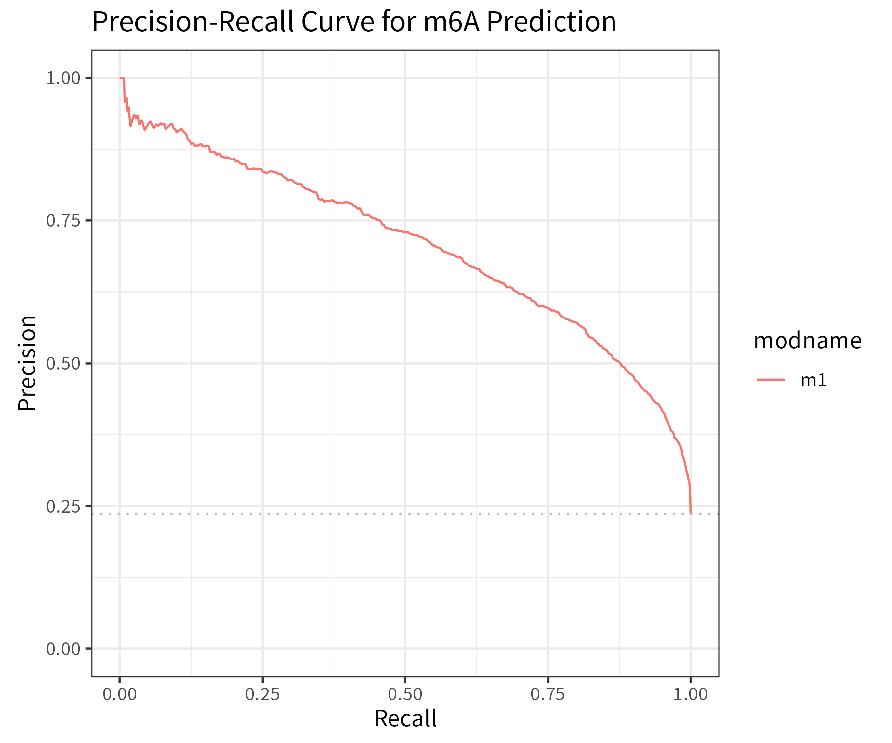

# m6APrediction

`m6APrediction` is an R package for predicting RNA
N6-methyladenosine (m6A) modification sites using a
pretrained Random Forest classifier.

The package supports predictions for both individual RNA
sites and multiple observations. It provides predicted
probabilities and binary classification results.

## Features

- Random Forest-based m6A site prediction
- Batch prediction using a CSV input table
- Single-site prediction using individual feature values
- Adjustable probability threshold for classification
- Pretrained model and example input data

## Installation

Install the package directly from GitHub:

```r
install.packages("remotes")
remotes::install_github("Loren233/m6APrediction")
library(m6APrediction)
```

## Input Features

The prediction functions use seven input features:

| Feature | Description |
|---|---|
| `gc_content` | GC content |
| `RNA_type` | RNA transcript type |
| `RNA_region` | RNA region |
| `exon_length` | Exon length |
| `distance_to_junction` | Distance to an exon junction |
| `evolutionary_conservation` | Evolutionary conservation score |
| `DNA_5mer` | Five-nucleotide sequence |

The package provides two exported functions:
`prediction_multiple()` and `prediction_single()`.

## Usage

### 1. Load the pretrained model

```r
library(m6APrediction)

rf_fit <- readRDS(
  system.file(
    "extdata", "rf_fit.rds",
    package = "m6APrediction"
  )
)
```

### 2. Multiple-site prediction

Load the included example dataset and predict m6A sites:

```r
example_data <- read.csv(
  system.file(
    "extdata", "m6A_input_example.csv",
    package = "m6APrediction"
  )
)

results <- prediction_multiple(
  ml_fit = rf_fit,
  feature_df = example_data,
  positive_threshold = 0.6
)

head(results)
```

The returned data frame contains the original input
features and two additional columns:

- `predicted_m6A_prob`: predicted probability of m6A
- `predicted_m6A_status`: Positive or Negative prediction

### 3. Single-site prediction

```r
result <- prediction_single(
  ml_fit = rf_fit,
  gc_content = 0.6,
  RNA_type = "mRNA",
  RNA_region = "CDS",
  exon_length = 12,
  distance_to_junction = 5,
  evolutionary_conservation = 0.8,
  DNA_5mer = "GGACA",
  positive_threshold = 0.5
)

print(result)
```

This function returns a named vector containing the
predicted m6A probability and classification status.

A site is classified as Positive when its predicted
probability exceeds the specified threshold.

## Model Performance

ROC and precision-recall (PRC) curves provide complementary
views of classification performance.

### Receiver Operating Characteristic (ROC)



### Precision-Recall Curve (PRC)



The evaluation dataset, model configuration, and performance
metrics should be reported alongside these figures to
support their interpretation.

## License

MIT License.
